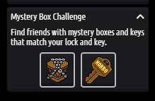

# Plugin Caixa Misteriosa de Natal

Este plugin adiciona a Caixa Misteriosa de Natal ao Arcturus Morningstar 3.5.x.



> [!TIP]
> Versão em Inglês [aqui](README.md)

- [Como instalar](#como-instalar)
- [FAQ](#faq)
    * [Geral](#geral)
    * [Item da Caixa Misteriosa](#item-da-caixa-misteriosa)
    * [Chaves da Mystery Box](#chaves-da-mystery-box)
    * [Recompensas da Mystery Box](#recompensas-da-mystery-box)
        + [Exemplo da tabela `mystery_rewards`](#exemplo-da-tabela-mystery_rewards)
- [Suporte](#suporte)

## Como instalar

1. Baixe a versão mais recente [aqui](https://github.com/brenoepics/MysteryBox-Plugin/releases)
2. Execute o arquivo sql em seu banco de dados
3. Adicione um item com a interação `mysterybox` à tabela `items_base`.
4. Cole o arquivo MysteryBoxPlugin.jar na pasta de plug-ins e inicie/reinicie o emulador.

## FAQ

### Geral

- `mysterybox.challenge.enabled` - O desafio de Natal está ativado? Padrão: true

### Item da Caixa Misteriosa

- Interaction type: `mysterybox`

Se você não possui o `items_base` para os móveis da Mystery Box (talvez sprite_id 4797), aqui está um exemplo.

```sql
INSERT INTO `items_base` (`sprite_id`, `public_name`, `item_name`, `type`, `width`, `length`, `stack_height`,
                          `allow_stack`, `allow_sit`, `allow_lay`, `allow_walk`, `allow_gift`, `allow_trade`,
                          `allow_recycle`, `allow_marketplace_sell`, `allow_inventory_stack`, `interaction_type`,
                          `interaction_modes_count`, `vending_ids`, `multiheight`, `customparams`, `effect_id_male`,
                          `effect_id_female`, `clothing_on_walk`)
VALUES (4797, 'Xmas Mystery Box', 'mystery_box', 's', 1, 1, 1.00, 1, 0, 0, 0, 1, 1, 0, 0, 1, 'mysterybox', 2, '0', '',
        '', 0, 0, '');
```

Em seguida, adicione na `catalog_items` usando o id gerado na consulta anterior ou faça uma wired dar o item, ou adicionar nos achievements...
para distribuir as caixas aos usuários.

### Chaves da Mystery Box

- `mysterybox.key.generate.time` - Tempo em segundos para gerar uma nova chave para o usuário. Padrão: 86400 (24h)
- `mysterybox.key.onlogin` - Se for verdadeiro, o usuário receberá uma nova chave no login. Padrão: true

As chaves são geradas automaticamente no login do usuário a cada 24h (`mysterybox.key.generate.time`)

### Recompensas da Mystery Box

- Você pode atualizar as recompensas com o comando `:mysterybox_update` (permissão `cmd_mystery_update`)
- Tipos de recompensa disponíveis:
    - Item de parede = i
    - Item de chão = s
    - Efeito = e
    - Habbo Clube = h ,

#### Exemplo da tabela `mystery_rewards`

| id | type | reward |
|----|------|--------|
| 1  | s    | 100    |
| 2  | i    | 101    |
| 3  | e    | 102    |
| 4  | h    | 1      |


## Suporte

Se precisar de ajuda, abra um ticket [aqui](https://github.com/brenoepics/MysteryBox-Plugin/issues/new)

Se você achar este plugin útil, considere dar uma ⭐.